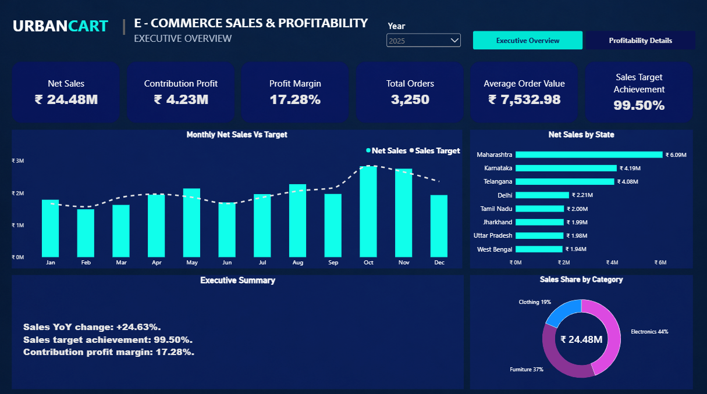
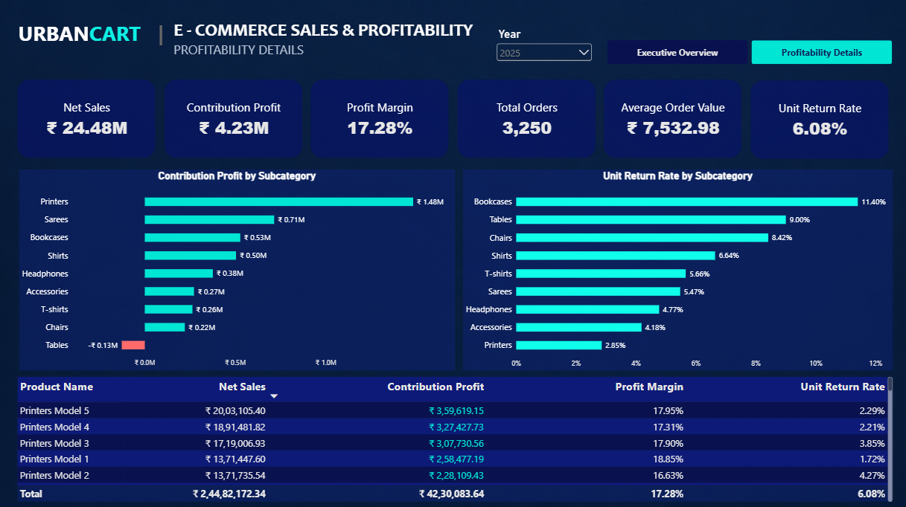
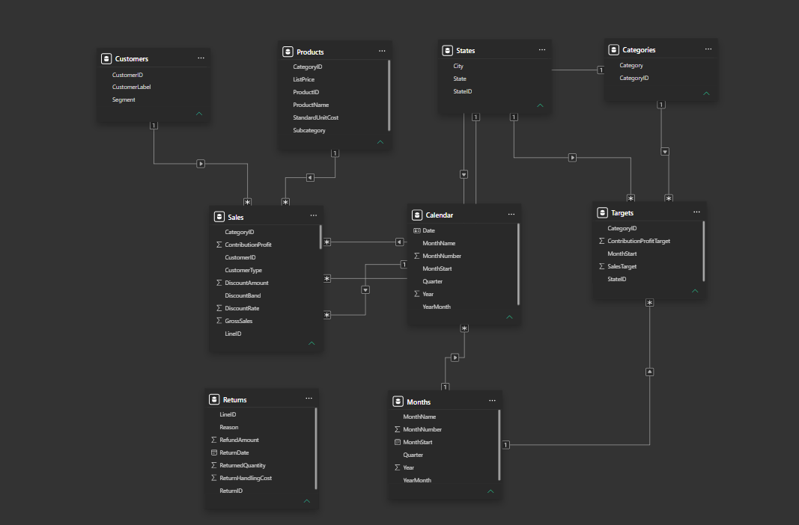

# UrbanCart | E-commerce Sales & Profitability

A two-page Power BI report analysing sales performance, target achievement, product profitability, and returns for a fictional e-commerce retailer.

## Business Objective

Help decision-makers understand:
- How sales are performing against targets and the previous year.
- Which states and categories contribute the most revenue.
- Which product subcategories generate profit or losses.
- Where high return rates warrant further investigation.

## Dataset

This portfolio project uses synthetic data for a fictional retailer, UrbanCart. It does not represent an actual company’s performance.

- Period: January 2024–December 2025
- Sales: 9,827 order-line records
- Targets: 576 monthly records across state and category combinations
- Currency: Indian rupees (INR)

The Sales source includes quantities, discounts, refunds, product costs, shipping costs, payment fees, and return-handling costs.

## Tools and Skills

- Power BI Desktop
- Power Query for CSV import and data types
- Data modelling and relationship configuration
- DAX measures and filter context
- Interactive report design
- Business analysis and recommendations

## Report Pages

### Executive Overview

Tracks Net Sales, Contribution Profit, Profit Margin, Total Orders, Average Order Value, and Sales Target Achievement.

Visuals cover monthly sales versus target, sales by state, category sales share, and an executive summary.

### Profitability Details

Examines contribution profit and unit return rate by subcategory, with a product-level table for detailed comparisons.

Conditional formatting highlights positive and negative contribution profit.

## Data Model

Sales and Targets use shared dimensions for category, state, and time.

- Customers and Products filter Sales.
- Categories and States filter both Sales and Targets.
- Months filters Targets directly and Sales through Calendar.
- Nine active relationships use one-to-many cardinality and single-direction filtering.

The Returns table is disconnected in the current model. Report return metrics use the ReturnedQuantity field already present in Sales.

## KPI Definitions

| KPI | Definition |
|---|---|
| Net Sales | Sales after discounts and refunds |
| Contribution Profit | Net Sales minus Net COGS, shipping, payment fees, and return-handling costs |
| Profit Margin | Contribution Profit / Net Sales |
| Total Orders | Distinct order count |
| Average Order Value | Net Sales / Total Orders |
| Unit Return Rate | Returned Units / Units Sold |
| Sales Target Achievement | Net Sales / Sales Target |
| Sales YoY Growth | (Net Sales − Previous Year Net Sales) / Previous Year Net Sales |

Profit Margin represents contribution margin, not net profit margin after all business expenses.

## Key Findings — 2025

- Net Sales reached ₹24.48 million, up 24.63% from 2024.
- Sales target achievement was 99.50%, with a shortfall of approximately ₹124,028.
- Contribution Profit reached ₹4.23 million, at a margin of 17.28%.
- The business recorded 3,250 orders and an average order value of ₹7,532.98.
- Unit Return Rate was 6.08%, compared with 6.93% in 2024.
- Printers generated the highest subcategory contribution profit, approximately ₹1.48 million.
- Tables recorded approximately ₹0.13 million in contribution losses.
- Bookcases had the highest subcategory unit return rate at 11.40%.

## Recommendations

1. Investigate Tables at product level, reviewing discounts, product costs, shipping, and returns before recommending pricing changes.
2. Analyse Bookcases return reasons to identify potential quality, packaging, or product-description issues.
3. Review monthly target gaps to identify where sales performance fell short.
4. Assess opportunities to grow profitable subcategories such as Printers while monitoring margins and returns.

These are proposed actions based on the analysis, not implemented business outcomes.

## Validation

Checks on the supplied Sales and Targets CSV files found:
- No missing values in either file.
- No duplicate Sales LineID values.
- No duplicate month–state–category target combinations.
- Sales arithmetic consistent with the source columns, allowing for rounding.
- Annual sales, profit, order counts, and return rates matching the report.
- 2025 target achievement matching the displayed 99.50%.

## Scope and Limitations

- Findings describe a synthetic business scenario.
- Return metrics follow the original order date, not the return-processing date.
- The previous-year measure compares selected months with the same months one year earlier.
- The PDF is a static snapshot; scrolling, slicers, and tooltips require the Power BI report.

## Project Files

| Folder | Contents |
|---|---|
| data | Source CSV files |
| powerbi | Power BI report (.pbix) |
| reports | Exported report PDF |
| screenshots | Report pages and model diagram |

## How to View

- Open the PDF in the reports folder for a quick overview.
- Open the .pbix file in Power BI Desktop to explore the interactive report.
- To refresh the data, update the CSV source paths to your local data folder.

## Author

Amit Srivastav